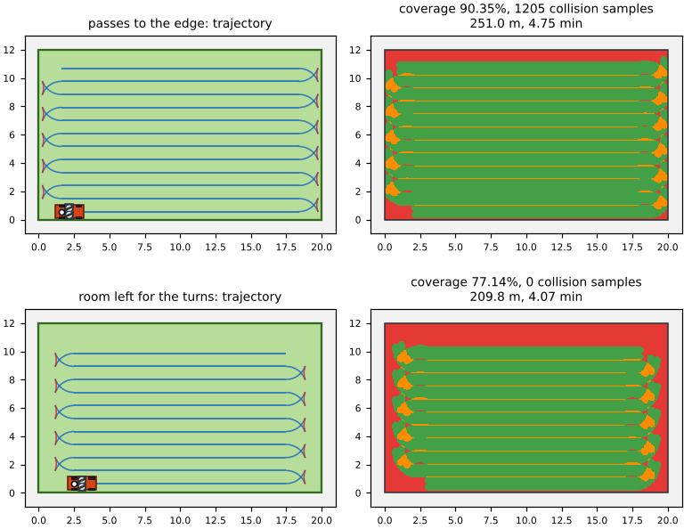

# mowersim: mowing a real lawn with a car-like robot

Coverage path planning for a robot mower that steers like a car: it has a
minimum turning radius, it can reverse, and it cuts a band of grass with the
blades of a deck placed between its axles. The lawn is a polygon in metres,
with holes for trees, flower beds and buildings.

This repository has two parts that go together:

* **a simulator**, the Python package `mowersim`: polygon lawns, the
  kinematic model of the mower, shortest Dubins and Reeds–Shepp paths, and a
  single function that measures any trajectory (area cut, missed and cut
  twice, collisions with the border, time, and a lower bound on the length);
* **a course**, [`course/main.pdf`](course/main.pdf), that derives everything
  the code does, with drawings of the mower seen from above, its turns and
  the area its blades sweep.

This is the first edition: the foundations. Planners (headland passes,
parallel swaths with feasible turns, decomposition of complex lawns, and
learning) come next, in the code and in the course.



## What the course covers

1. **Introduction**: from a grid of cells to a real lawn and a real machine.
2. **The lawn**: polygons with holes, the shoelace formula, the
   point-in-polygon test, and the raster on which coverage is measured, with
   a bound on its error.
3. **The mower**: its dimensions seen from above, the kinematic bicycle model
   derived from rolling without slipping, Ackermann steering, exact motion on
   arcs, and the area swept by the blades in a turn.
4. **Shortest paths**: Dubins (forward only) and Reeds–Shepp (with reverse)
   paths, and the manoeuvre every mowing pattern needs, turning into the next
   strip: with reverse, a 4.5 m three-point turn instead of a 9.3 m loop.
5. **Measuring a path**: coverage, collisions, time, a lower bound on the
   mowing length, and a first experiment showing why the border needs
   headland passes.

## Install and run

```bash
pip install -e ".[gif,test]"
python -m mowersim mower                       # the mower seen from above
python -m mowersim show lawns/garden.json      # a lawn and the mower at its start
python -m mowersim path 0 0.92 180 --compare   # Dubins vs Reeds-Shepp to the next strip
python -m mowersim demo lawns/rectangle.json --png demo.png --gif demo.gif
python -m mowersim evaluate lawns/rectangle.json my_trajectory.json
python -m pytest
```

Every command accepts `--mower my_mower.json`. The default mower
(`mower.json`) is a typical tractor-style ride-on: 1.20 m wheelbase, 40°
maximum steering angle (1.43 m minimum turning radius), two blades cutting
0.97 m. To simulate another machine, measure its turning radius, the position
of its deck and its speeds (see the appendix of the course).

## Layout

```
mowersim/
  geometry.py     lawns: polygons with holes, area, point-in-polygon
  mower.py        the mower's dimensions, deck and blades, speeds
  kinematics.py   bicycle model, exact arcs, trajectories
  paths.py        Dubins and Reeds-Shepp shortest paths, time of a path
  coverage.py     raster, cut area and passes, collisions, lower bound: evaluate()
  viz.py          top views of the lawn, the mower, trajectories and coverage
  demo.py         back and forth on the bounding box (an experiment, not a planner)
lawns/            example lawns (JSON)
course/           the course (LaTeX) and its figures
tools/            scripts that write the example lawns and the figures of the course
tests/            tests (rsplan, if installed, serves as an independent oracle)
```

Lawns and trajectories are JSON files: a lawn is a list of vertices in metres
(`outer`, optional `holes` and `start`), a trajectory a start pose and a list
of segments, each with a curvature, a length, a direction and whether the
blades are on.

## Building the course

```bash
python tools/course_figures.py     # figures drawn by the code
cd course && latexmk -pdf main.tex
```

## License

MIT, see [LICENSE](LICENSE).
