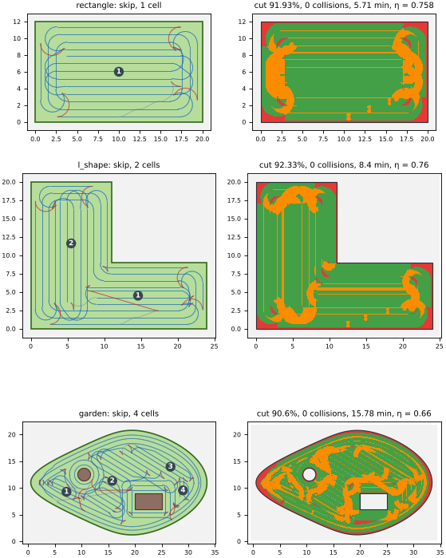

# mowersim: mowing a real lawn with a car-like robot

Coverage path planning for a robot mower that steers like a car: it has a
minimum turning radius, it can reverse, and it cuts a band of grass with the
blades of a deck placed between its axles. The lawn is a polygon in metres,
with holes for trees, flower beds and buildings.

This repository has two parts that go together:

* **a simulator and planner**, the Python package `mowersim`: polygon lawns,
  the kinematic model of the mower, Dubins and Reeds–Shepp paths, a planner
  (headland passes, parallel swaths with drivable turns, decomposition of
  complex lawns into cells, the order of the cells, Hybrid A* around
  obstacles), paths that a steering of limited speed can follow, a simulated
  controller with localisation errors, and a single function that measures
  any trajectory (area cut, missed and cut twice, collisions with the border,
  time, and a lower bound on the length);
* **a course**, [`course/main.pdf`](course/main.pdf), that derives everything
  the code does, with drawings of the mower seen from above, its turns and
  the area its blades sweep.

On the three example lawns the planner mows 91–92% of the grass with no
collision: the 20 m × 12 m rectangle in 5.7 minutes, the L-shaped lawn in
8.4 minutes, the garden with a tree and a flower bed in 15.8 minutes. What is
left uncut is mostly a 13 cm strip along the border, out of reach of the
blades (the job of a string trimmer), and the corners.



## What the course covers

1. **Introduction**: what a good path is, and what the course covers.
2. **The lawn**: polygons with holes, the shoelace formula, the
   point-in-polygon test, and the raster on which coverage is measured, with
   a bound on its error.
3. **The mower**: its dimensions seen from above, the kinematic bicycle model
   derived from rolling without slipping, Ackermann steering, exact motion on
   arcs, and the area swept by the blades in a turn.
4. **Shortest paths**: Dubins (forward only) and Reeds–Shepp (with reverse)
   paths, and the manoeuvre every mowing pattern needs, turning into the next
   strip: with reverse, a 4.5 m three-point turn instead of a 9.3 m loop.
5. **Measuring a path**: coverage, collisions, time, a lower bound on the
   mowing length, and a first experiment showing why the border needs
   headland passes.
6. **Headlands**: offsetting the lawn, the clearance a car's swing-out needs,
   fillets, corners by shifted arcs or manoeuvres, how many passes.
7. **Swaths and turns**: placing the passes, why the next pass starts 2d
   further out, forward turns over a jump, the order of the passes, the
   direction from the minimum width.
8. **Splitting complex lawns**: the boustrophedon decomposition into
   monotone cells, keeping the ends of the passes in line, a direction per
   cell.
9. **Order and transfers**: the order of the cells as a generalised
   travelling salesman problem (Held–Karp), Hybrid A*, the complete planner
   and where its time goes.
10. **Smooth steering**: the rate of the steering, clothoids, turns with
    ramps, smoothing and planning with them.
11. **Following the path**: a feedback controller and pure pursuit,
    localisation noise, and what the errors cost in coverage.
12. **Search and learning**: how good the quick estimates are, planning every
    option, learning a better estimate, and what is left.

## Install and run

```bash
pip install -e ".[gif,test]"
python -m mowersim plan lawns/garden.json --png garden.png    # the complete planner
python -m mowersim plan lawns/garden.json --smooth --follow 0.02 --png driven.png
python -m mowersim mower                       # the mower seen from above
python -m mowersim show lawns/garden.json      # a lawn and the mower at its start
python -m mowersim path 0 0.92 180 --compare   # Dubins vs Reeds-Shepp to the next strip
python -m mowersim evaluate lawns/rectangle.json my_trajectory.json
python -m pytest
```

`plan` options: `--pattern adjacent|skip|best` (order of the passes),
`--order optimal|greedy` (order of the cells), `--smooth` (curvature ramps for
the steering), `--directions estimate|search`, `--follow SIGMA` (drive the plan
with a simulated controller and SIGMA metres of localisation noise),
`--save traj.json`, `--png`, `--gif`.

Every command accepts `--mower my_mower.json`. The default mower
(`mower.json`) is a typical tractor-style ride-on: 1.20 m wheelbase, 40°
maximum steering angle (1.43 m minimum turning radius), two blades cutting
0.97 m. To simulate another machine, measure its turning radius, the position
of its deck and its speeds (see the appendix of the course).

## Layout

```
mowersim/
  geometry.py     lawns: polygons with holes, area, point-in-polygon
  mower.py        the mower's dimensions, deck and blades, speeds, steering rate
  kinematics.py   bicycle model, exact arcs, trajectories
  paths.py        Dubins and Reeds-Shepp shortest paths, time of a path
  coverage.py     raster, cut area and passes, collisions, lower bound: evaluate()
  smooth.py       curvature ramps (clothoids) for a steering of limited speed
  follow.py       a simulated controller driving a plan, with localisation noise
  viz.py          top views of the lawn, the mower, trajectories and coverage
  demo.py         back and forth on the bounding box (an experiment, not a planner)
  planning/
    common.py     collision checker for the mower's footprint, Reeds-Shepp connections
    headland.py   headland rings: offsets, fillets, corners, joining the rings
    swaths.py     parallel passes, turns, order and direction of the passes
    cells.py      boustrophedon decomposition into monotone cells
    search.py     Hybrid A* for paths around obstacles
    planner.py    the complete planner: cells, their order, transfers
    learn.py      estimates, a learned model and search for the direction of a cell
lawns/            example lawns (JSON)
course/           the course (LaTeX) and its figures
tools/            scripts that write the example lawns and the figures of the course
tests/            tests (rsplan, if installed, serves as an independent oracle)
```

Lawns and trajectories are JSON files: a lawn is a list of vertices in metres
(`outer`, optional `holes` and `start`), a trajectory a start pose and a list
of segments, each with a curvature, a length, a direction and whether the
blades are on.

## Building the course

```bash
python tools/course_figures.py          # all figures drawn by the code (slow)
python tools/course_figures.py ch9      # or those of one chapter: ch2-5, ch6 ... ch12
cd course && latexmk -pdf main.tex
```

## License

MIT, see [LICENSE](LICENSE).
